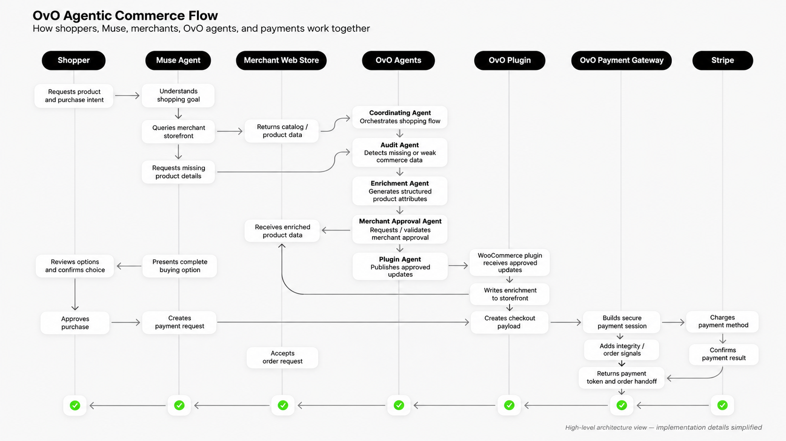

## Start here, judges

1. Live OvO Harness: https://wsiventures.com/ovoharness/index.html?v=14
Use the version link above. The plain link can serve a stale server-cached copy.

Harness code: repository gfields-wsi/ovo, branch ovo-harness, folder ovo-harness/
Commit: 93b9090d07b82fc02d9dea01c39fc751b1ac3790 (2026-11-04)
Harness code was not merged to main. Judge docs were added to main on 2026-11-04.

Demo video (3 minutes): https://youtube.com/shorts/i1ncawyazM0

## The demo, in three steps

Locked task for the judged run: City Chelsea Rain Boots, black, size 10,
$1 CAD, product 23, at https://wsiventures.com/solemates

1. Run Before. The agent reads the store only, with no OVO fields.
   It stops, and the screen states the exact reason: the agent will not
   pay unless it can verify material, fit, returns, stock, and the exact
   total from structured fields. A fact in description prose alone does
   not count as a structured field.
2. Run OvO. Audit, Enrichment, Merchant Approval, and Publish, in that
   order. Each stage shows its own output, source, and log.
3. Run After. The agent reads the store plus the OVO fields. It shows
   the same fields now present as structured data, the exact total
   re-checked from live store data, and the test order in the store's
   own order list.

Full judge instructions: see JUDGE.md in this folder.

## Honest limits, up front

- Test mode only. No live customer payment.
- Agent payment, MVP, research preview: test mode only, test card only, no real Link yet, no real customer payment yet. Bridge version 0.5.0-test is installed on Sole Mates. Test orders 132, 135, and 136 prove the agent test checkout. A judge-entered browser test order is a fallback record only, not an agent payment.
- Publish is live for this demo store only, approval-gated, product 23
  only, additional_property fields only, token held on the host only.
- Do not claim full MCP, ACP, or UCP compliance, consumer Muse personal
  agent discovery unless tested in the actual product, live customer
  payment, production plug-in compatibility, or broad SMB onboarding.
- Payment stays pass-through: the merchant's checkout and processor,
  the merchant as merchant of record.

## How Meta tools are used, in two separate parts

Builder partner: Meta Muse, the personal agent, built and wired the
harness in its own virtual machine, iterated on it with Greg, checked
it in a real browser preview, and verified the push by reading the
branch back. [GREG TO CONFIRM: exact split between Codex files and
Muse fixes, before this paragraph is published.]

Runtime: Muse Spark 1.3, through the Meta Model API, is what the
harness calls when it shops and when it checks audit work. The harness
shows this live, with model, purpose, duration, and outcome, and no
key ever appears on screen. Audit and enrichment are deterministic
first. Spark only checks or shops. No Meta call is simulated.

## OvO, in one sentence

OvO makes a small business web store shoppable by AI agents. It does not sell anything itself. It audits a store, enriches product data, gets merchant approval, publishes the fix in place on the merchant's own store, and supports an agent purchase.

This is an MVP, a research preview, built in a few days. It does not overstate, and it does not understate, what was completed. Test mode only, test card only, no real Link yet, no real customer payment yet.

## Capabilities, MVP

- Audit a store for missing structured fields: working, live, in the harness.
- Enrich Material, Fit, and Returns from store text: working, live, 36 rows published for 12 products on November 2, 2026.
- Merchant approval by group: working, in the harness, where the judge acts as merchant for the demo. Silence never counts as approval.
- Publish approved fields in place, through the plugin: working, live, with batch IDs recorded in the harness.
- Agent checkout, MVP, research preview: working in test mode only, test card only, test orders 132, 135, and 136. Order 132 used a test helper token. Orders 135 and 136 used a test card, with no Link token.
- Agent checkout, real Link: next step, not done yet. No Stripe profile ID yet, and no Link spend request step yet.
- Render deployment: next step, not done yet. The judged run uses the cPanel link above.

## How it works

The diagram below is a high level flow. It is simplified, and it is not a code diagram.

Caption: This flow shows the intended roles, not the exact code path. In the live demo, the agent must verify material, fit, returns, stock, and the exact total from structured data before any payment, and must stop with no payment and no order if any of those are missing. The OvO Payment Bridge calls Stripe, through the merchant Stripe account, in test mode only, and creates a WooCommerce order only after Stripe confirms. Real Link payment is not shown as a proven step, because it is not proven yet.

## Meta AI implementation, MVP

Model used in the harness: Muse Spark 1.3, through the Meta Model API, through a server proxy. No key is in browser code, and no key is in logs.

What Muse does: it checks the Audit gaps, and it makes the Before and After shopping decisions, with a trace for each call. The trace shows model, purpose, duration, and outcome. Token counts are shown only if the API returns them, and are never estimated.

What Muse does not do: it does not invent price, stock, or policy. Enrichment proposals come from store text, with a source for each field. Publish does not happen without a recorded, matching approval. Payment does not happen unless material, fit, returns, stock, and the exact total are verified from structured data.

What is deterministic code, not model work: Audit gap finding is deterministic first, then checked by the model. The bridge checkout checks, in order, are code: agent token, merchant approval, live price and stock re-check, currency, and idempotency.

## Technical architecture and stack, MVP

- Store: WordPress plus WooCommerce, Sole Mates mock store, 12 products at $1 Canadian.
- Harness: static page, plus two server proxies, meta.php for Meta calls, and publish.php for live publish. Tokens and keys live in host settings only, never in browser code.
- Plugin: OvO Enrichment, version 0.2.0-demo, live endpoint for OVO fields, and a diff endpoint for publish, gated by token plus approval fields.
- Bridge: OvO Payment Bridge, version 0.5.0-test, live, test mode only, with a manifest endpoint and a checkout endpoint.
- Evaluation: Before versus After, on the same locked task, with field coverage, agent action, blocking reason, and order verification.

## Repository map and reproducibility, MVP

Public files, on main: README.md, JUDGE.md, SETUP.md, docs, eval, and the Sole Mates store source.

Public harness code: branch ovo-harness, folder ovo-harness, commit 93b9090d07b82fc02d9dea01c39fc751b1ac3790. Live link: version 14 above.

Public bridge code: branch payment-bridge, folder ovo-payment-bridge, commit 2c7bca4254093ec743e246f298c2264dbc096a11, version 0.5.0-test.

To reproduce, with no credentials: open the harness link, press Run Judge Test, then Run OvO, then Run After, then open Logs and press Export Run JSON. To reproduce the Meta calls live, the host proxy needs a Meta key, which is not in the repo and is not shared.

## Known limitations and roadmap, MVP

MVP scope now: test mode only, no real Link yet, no real customer payment yet, no Render deployment yet, run logs are browser only unless exported, and the plugin revert step is admin only.

Next, in order: real Link, with a Stripe profile ID and a Link spend request step; a documented public interface for private components, with sanitized traces; and a Render deployment, if it is still needed after the cPanel judged run.

---

# OvO

VIP Shopping Experience for AI Agents

OvO makes an SMB storefront shoppable by AI agents, on the store's own URL. OvO is the layer that fixes the store. OvO is not the shop.

## Status

Decision 0 DECIDED 2026-10-29 by Greg: Startup track, Build for Your World theme, OVO as the behind-the-scenes enabler, not the buyer. See docs/decision-0-and-mapping.md.

Live demo store: https://wsiventures.com/solemates — WordPress + WooCommerce, 12 products at $1 CAD, live, with a $1 Cash on delivery test order (#119) and a $1 Stripe test-mode order (#122) completed. Bridge test orders, all $1 CAD, test mode only: #132 (test helper token), #135 and #136 (test card only, no Link token).

Day-one progress 2026-10-29: Muse Spark 1.3 tool calling and streaming verified via the Meta Model API; Store API products and cart verified (via `?rest_route=`); product JSON-LD present; Stripe test mode live in the store checkout. Agent Store API checkout with Stripe is still open: Stripe requires a payment token made through its own payment form, and a direct API token call is blocked. (Historical, October 29, 2026. Superseded November 4, 2026, by the bridge MVP, test orders 132, 135, and 136.)

## Structure

- `sole-mates/` — Sole Mates mock store, WordPress plus WooCommerce, 10+ products (12 in the current storefront, 79 variations).
- `ovo-plugin/` — Small WooCommerce plugin that publishes enrichment in place, with originals kept for revert.
- `ovo-agent/` — Audit, enrich, and shopping-agent tools, powered by Meta models.
- `eval/` — Golden tasks, ground truth, before-and-after runs, and red-team runs.
- `docs/` — Decision 0 and R1 to R10 mapping, day-one tests, and build order.

## Dates

Feature freeze: Nov 2, 2026.
Submissions due: Nov 4, 2026, at 9:00 PM ET. Submit before noon ET Nov 4 as a buffer, from a frozen build.
Judging: Nov 4 to 8, 2026.
Finals: Nov 9, 2026.

## Honest limits

Do not claim full MCP, ACP, or UCP compliance, consumer Muse personal agent discovery unless tested in the actual product, live customer payment, production plugin compatibility, or broad SMB onboarding. Payment stays pass-through: the merchant's checkout and processor, the merchant as merchant of record. Demo payment is Stripe test mode, labelled as such.
