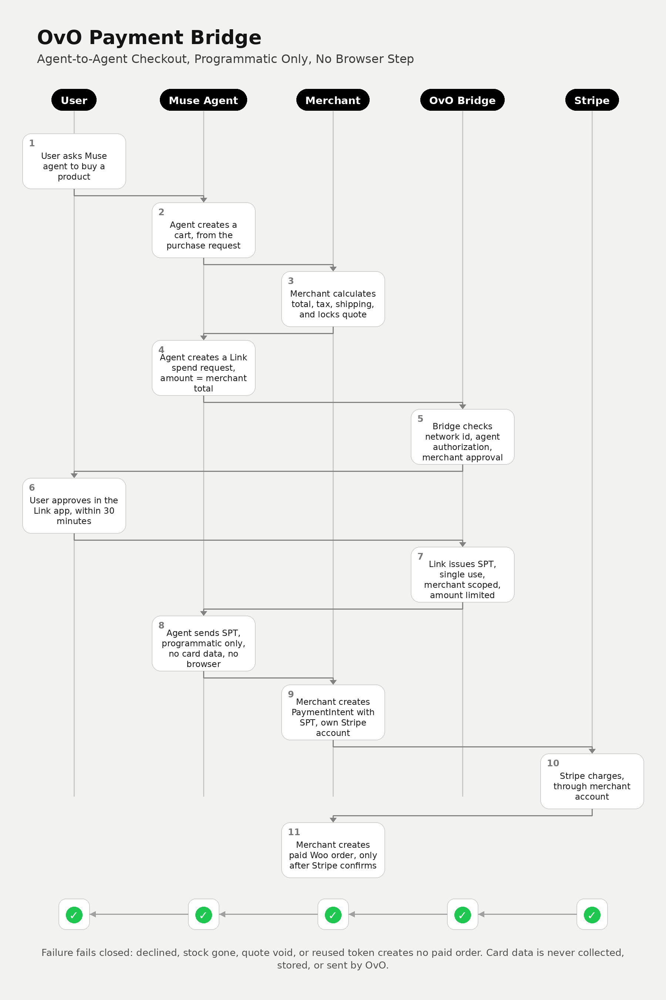

# OvO Payment Bridge — Separate Component, Test Mode Only

Status: Code implementation in workspace, 2026-11-02, test mode only, mocks only. bridge.py plus test_bridge_full.py pass all 22 requirements in mock form. Not deployed to Sole Mates. No live charges. No changes to the enrichment plugin. Level B Link approval and live acceptance criteria are NOT proven, and are blocked on inputs below.

Blocked, not code gaps: real merchant network id, real Link wallet spend request and customer approval, Stripe preview API access and secret key via Secure Vault, merchant bridge approval for a live store, CAD SPT test result, and Greg's separate approval to deploy to Sole Mates and to charge live. Without those, Requirements 22.2, 22.3, and 20.2 cannot pass, and no live claim is made.

First store, Sole Mates, merchant Stripe account id, provided by Greg 2026-11-02: [Sole Mates merchant Stripe account id, provided separately, not published]. Network id / profile id for this account is still to be derived, via Stripe with a secret key, or via a 402 challenge. Do not use this account id as a network id without verification.

Scope: Agent to merchant, programmatic only, no browser step. WordPress plus WooCommerce only. Stripe only. Meta Muse as reference agent only. Generic for all OvO merchant customers, on all their web stores. Sole Mates is only the first store, for proof. Store address, merchant id, and seller network id are inputs per merchant, never hard coded to Sole Mates. Product and amount are inputs per purchase request, never hard coded. Linked Stripe card authentication happens per purchase request, via Link spend request approval at that time, never as a pre-saved token reused without approval.

Generic core, built 2026-11-02: core_generic.py plus test_core_generic.py, Requirements 1-22, no Sole Mates store, URL, or account id in those files, no live purchase session required for tests. Tests passed. External adapters for Link, Stripe, and WooCommerce are injected interfaces with mock adapters for tests; real adapters, Level B Link approval, and live charge are NOT proven by these tests.

Source of truth: `../ovo-plugin/PAYMENT-BRIDGE-REQUIREMENTS-2026-11-02.md` — 22 requirements, each with distinct acceptance criteria.

## Flow diagram

The diagram below shows the agent-to-agent flow, programmatic only, with no browser step. It is built from `build_diagram.py`, and the image file is in this same folder, so it renders on GitHub.

Flow, in order:
1. User asks Muse agent to buy a product.
2. Agent creates a cart, from the purchase request.
3. Merchant calculates total, tax, shipping, and locks quote.
4. Agent creates a Link spend request, amount = merchant total.
5. Bridge checks network id, agent authorization, merchant approval.
6. User approves in the Link app, within 30 minutes.
7. Link issues SPT, single use, merchant scoped, amount limited.
8. Agent sends SPT, programmatic only, no card data, no browser.
9. Merchant creates PaymentIntent with SPT, own Stripe account.
10. Stripe charges, through merchant account.
11. Merchant creates paid Woo order, only after Stripe confirms.

Failure fails closed: declined, stock gone, quote void, or reused token creates no paid order. Card data is never collected, stored, or sent by OvO.

Boundaries, locked for this build:
- Merchant stays as merchant of record. Money stays with the merchant.
- OvO does not collect a card, store a card, or charge the buyer.
- Payment credential is a Shared Payment Token, SPT, id starting with `spt_`, issued by a Link spend request, credential type shared payment token, seller network id only.
- No browser checkout, no Link Pay Token, no virtual card form, no UCP Link completion.
- Test mode gate, split into Level A merchant redemption test, then Level B Link end to end test, then live only after both pass.
- Live CAD is gated on a CAD SPT test passing, otherwise live scope is USD only for the first live release.
- Endpoint paths in the requirements are proposed, not existing, and are used here as proposed: `/ovo-bridge/v1/manifest` and POST `/ovo-bridge/v1/checkout/complete`.
- Rate limits are proposed defaults, not merchant confirmed limits.
- No Stripe secret key is stored in this code. Any live Stripe call requires a key supplied via environment, test mode only, and fails closed if missing.
- No deployment to Sole Mates, no install on a live store, and no live charge without Greg's separate approval for that deployment step.

Work order:
1. Manifest, seller network id, agent authorization, merchant approval, cart, quote lock — Requirements 1 to 6.
2. Link SPT spend request, approval, SPT limits, programmatic submission, PaymentIntent charging — Requirements 7 to 12.
3. WooCommerce order, audit log, idempotency, failure closed, amount increase, refunds, rate limiting — Requirements 13 to 19.
4. Currency gate, separation, test mode Level A and Level B gates — Requirements 20 to 22.
5. Acceptance tests against mocks and test helper patterns, with verified-only results reported, no claim of live success until live tests pass.
